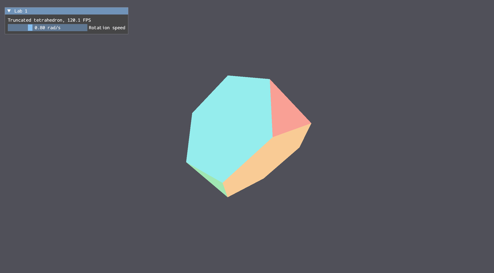
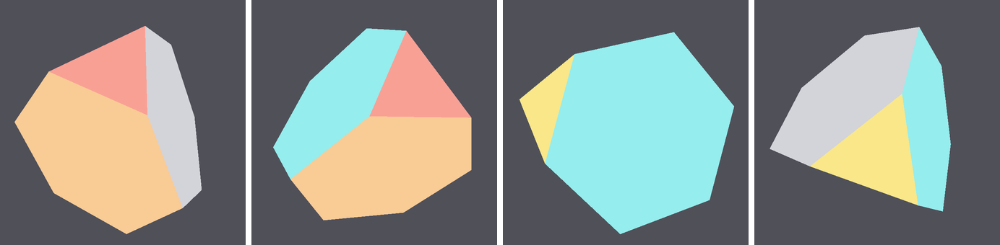

# Lab 1. 3D Graphics Basics: Truncated Tetrahedron

A rotating truncated regular tetrahedron drawn with Vulkan in perspective projection, with the rotation speed controlled from ImGui.

## Task

Render a simple 3D object in real time with Vulkan, GLFW and ImGui and project it onto the screen with a perspective matrix.
Variant 4: a truncated regular tetrahedron, whose faces are 4 regular triangles and 4 regular hexagons.
The base task without extra tasks is done: the object rotates, every face has its own color, and the rotation speed is changed in the interface.

## Build and run

Requirements: a C++20 compiler, CMake 3.20+ and the Vulkan SDK with `glslc` in `PATH`.

```bash
make run LAB=lab1
```

On Windows run `mingw32-make run LAB=lab1`; the preset is chosen by `PRESET=` (`mingw-debug` on Windows, `debug` on GNU/Linux).

## Example

The `Lab 1` window shows the frame rate and the `Rotation speed` slider from 0 to 3 rad/s.





## Notes

- The tetrahedron corners are $(1, 1, 1)$, $(1, -1, -1)$, $(-1, 1, -1)$, $(-1, -1, 1)$; every edge $A_iA_j$ is cut at one third, $P_{ij} = \frac{2A_i + A_j}{3}$, which gives 12 vertices, 18 edges and 8 faces.
- All vectors $2A_i + A_j$ have the length $\sqrt{11}$, so normalizing them only scales the solid and puts its vertices on the unit sphere.
- Every face has its own vertices and color and is oriented counterclockwise from the outside; hexagons are split into 4 triangles as a fan, 20 triangles and 60 indices in total.
- The vertex shader gets one matrix $MVP = P \cdot V \cdot M$ from a uniform buffer: $M$ rotates the object around the axis $(0.3, 1, 0.2)$, $V$ looks from $(0, 1.2, 3.5)$ at the origin.
- $P$ is `glm::perspectiveRH_ZO` with a 60° field of view and the $y$ axis flipped, because in Vulkan $y$ points down and depth is in $[0, 1]$.
- Back faces are culled and the depth test is `LESS`; the viewport and the scissor are dynamic, so resizing the window does not rebuild the pipeline.
- The rotation angle grows by $\omega \cdot \Delta t$ every frame, so the speed does not depend on the frame rate.
