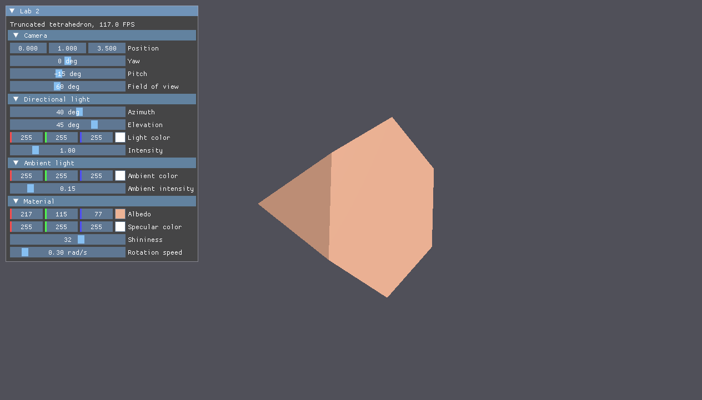
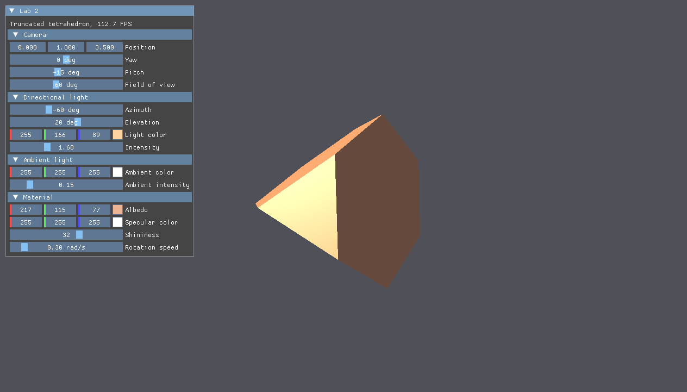
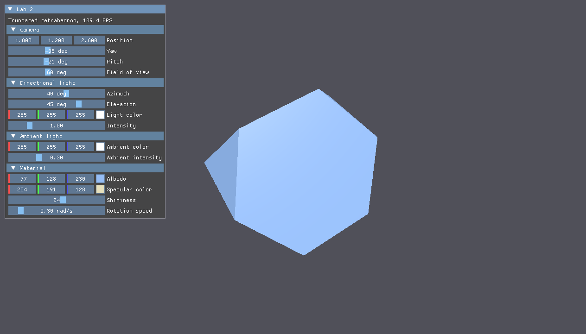

# Lab 2. Camera and Lighting: Blinn-Phong

## Task

Draw the object from lab 1 relative to a movable camera and light it with the Blinn-Phong model.
Variant 4: the truncated regular tetrahedron with procedurally generated face normals.
The base task without extra tasks is done: one directional light, and the camera, the light, the ambient light and the material are changed in the ImGui interface.

## Build and run

Requirements: a C++20 compiler, CMake 3.20+ and the Vulkan SDK with `glslc` in `PATH`.

```bash
make run LAB=lab2
```

On Windows run `mingw32-make run LAB=lab2`; the preset is chosen by `PRESET=` (`mingw-debug` on Windows, `debug` on GNU/Linux).

## Example

The `Lab 2` window holds the camera position, yaw, pitch and field of view, the light azimuth, elevation, color and intensity, the ambient color and intensity, the material albedo, specular color and shininess, and the rotation speed.





Reports: [Russian](docs/report-ru.pdf), [English](docs/report-en.pdf).

## Notes

- The normal of a face is $\mathbf{n} = \frac{(b - a) \times (c - a)}{|(b - a) \times (c - a)|}$, faces do not share vertices, so the lighting is flat.
- The view matrix is $V = \operatorname{lookAt}(p, p + f, up)$ with $f = (\cos\theta \sin\varphi, \sin\theta, -\cos\theta \cos\varphi)$ for yaw $\varphi$ and pitch $\theta$.
- Normals go to world space with the normal matrix $(M^{-1})^T$.
- With $l = -d$, $h = \frac{l + v}{|l + v|}$: $C = k_a A \cdot \text{albedo} + (\text{albedo} \max(n \cdot l, 0) + \text{specular} \max(n \cdot h, 0)^{s}) \cdot L$.
- All uniform fields are `mat4` or `vec4`, so the std140 layout matches the C++ structure without padding.
