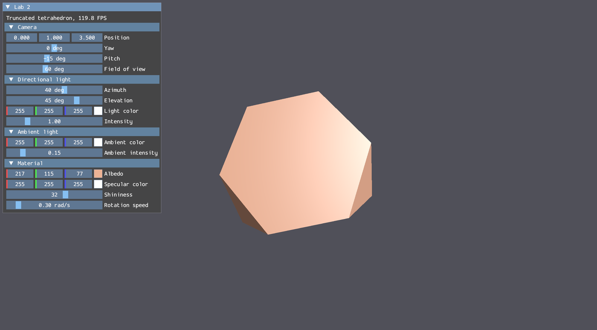
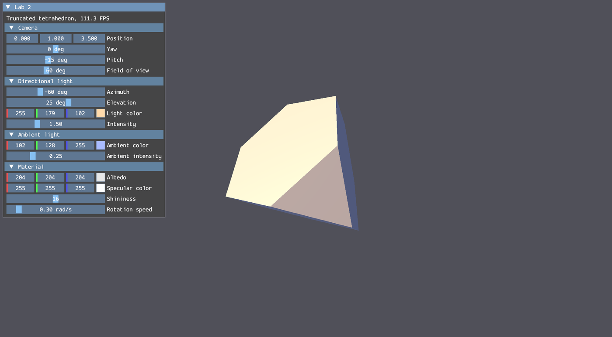
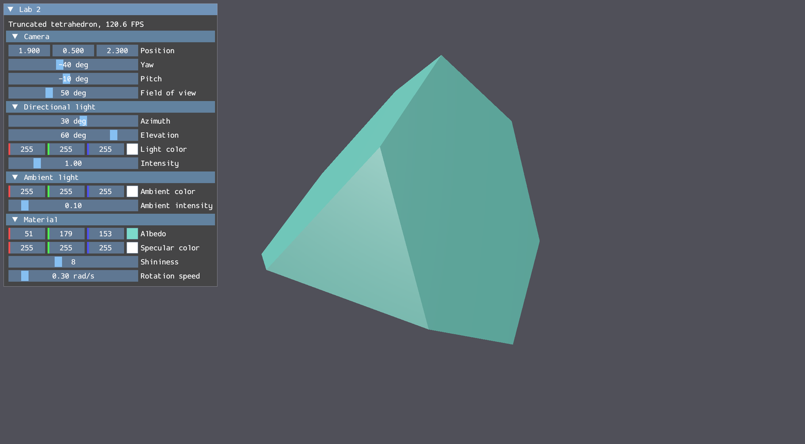

# Lab 2. Camera and Lighting: Blinn-Phong

The truncated tetrahedron from lab 1 seen through a movable camera and lit by a directional light with the Blinn-Phong model, with every parameter controlled from ImGui.

## Task

Draw the object from lab 1 relative to a movable camera and light it with the Blinn-Phong model.
Variant 4: the truncated regular tetrahedron with procedurally generated face normals.
The base task without extra tasks is done: one directional light, and the camera, the light, the ambient light and the material are changed in the ImGui interface.

## Build and run

Requirements: a C++20 compiler, CMake 3.20+ and the Vulkan SDK with `glslc` in `PATH`.

```bash
make run LAB=lab2
```

On Windows run `mingw32-make run LAB=lab2`; the preset is chosen by `PRESET=` (`mingw-debug` on Windows, `debug` on GNU/Linux).

## Example

The `Lab 2` window holds the camera position, yaw, pitch and field of view, the light azimuth, elevation, color and intensity, the ambient color and intensity, the material albedo, specular color and shininess, and the rotation speed.







## Notes

- The normal of a face is $n = \frac{(b - a) \times (c - a)}{\lVert (b - a) \times (c - a) \rVert}$, faces do not share vertices, so the lighting is flat.
- The view direction for yaw $\varphi$ and pitch $\theta$ is $f = (\cos\theta \sin\varphi, \sin\theta, -\cos\theta \cos\varphi)$ and $V = \mathrm{lookAt}(p, p + f, \text{up})$; the pitch is limited to $\pm 89^\circ$, where `lookAt` stays defined.
- The direction to the light for azimuth $a$ and elevation $e$ is $t = (\cos e \sin a, \sin e, \cos e \cos a)$; the uniform buffer stores the ray direction $d = -t$.
- The vertex shader passes the world position and the normal transformed by the normal matrix $(M^{-1})^T$; the lighting is computed per fragment.
- With $l = -d$, the direction to the camera $v$ and $h = \frac{l + v}{\lVert l + v \rVert}$, the color is
  $C = k_a A \cdot \text{albedo} + \text{albedo} \max(n \cdot l, 0) L + \text{specular} \max(n \cdot h, 0)^{s} L$,
  where $A$ and $k_a$ are the ambient color and intensity, $L$ is the light color times its intensity and $s$ is the shininess;
  colors are multiplied component-wise, and the specular term is zero when $n \cdot l \le 0$.
- All uniform fields are `mat4` or `vec4`, so the std140 layout matches the C++ structure without padding.
