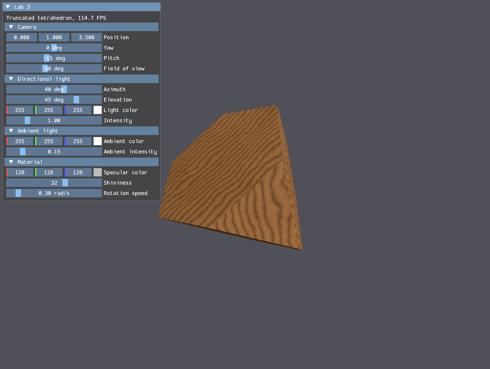

# Lab 3. Texture Mapping

## Task

Load an image from the file system, create a texture from it and use it as the albedo of the object from lab 2.
Variant 4: the truncated regular tetrahedron with procedurally generated normals and texture coordinates.
The base task without extra tasks is done: one texture, no push constants, the object properties live in one dynamic uniform buffer, and the vertex and index data are in VRAM.

## Build and run

Requirements: a C++20 compiler, CMake 3.20+ and the Vulkan SDK with `glslc` in `PATH`.

```bash
make run LAB=lab3
```

On Windows run `mingw32-make run LAB=lab3`; the preset is chosen by `PRESET=` (`mingw-debug` on Windows, `debug` on GNU/Linux).

## Example

The `Lab 3` window holds the same camera, light and ambient parameters as lab 2; the material keeps the specular color and shininess, while the albedo comes from `textures/wood.png`.



## Notes

- The image is decoded by [lodepng](https://github.com/lvandeve/lodepng) to RGBA8 and stored as `VK_FORMAT_R8G8B8A8_SRGB`, so the sampler returns linear colors.
- The texture coordinates of a face are its planar projection: with the face center $c$, $u = \frac{p_1 - p_0}{\lVert p_1 - p_0 \rVert}$ and $v = n \times u$, a vertex $p$ gets $\text{uv} = 0.5 + 0.55 \left((p - c) \cdot u, (p - c) \cdot v\right)$.
- One staging buffer holds the pixels, the vertices and the indices; one command buffer moves the image to `TRANSFER_DST_OPTIMAL`, copies everything to device-local memory and moves the image to `SHADER_READ_ONLY_OPTIMAL`.
- The descriptor set has a `UNIFORM_BUFFER_DYNAMIC` at binding 0 and a `COMBINED_IMAGE_SAMPLER` at binding 1; the dynamic offset of the object is passed to `vkCmdBindDescriptorSets`.
- The fragment shader is the Blinn-Phong model of lab 2 with `albedo = texture(albedo_texture, uv).rgb`.
