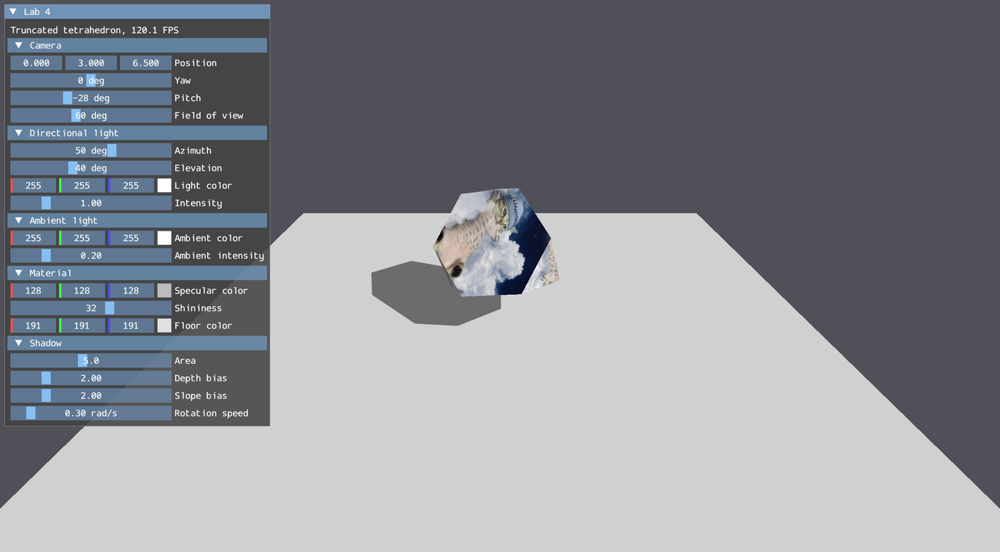
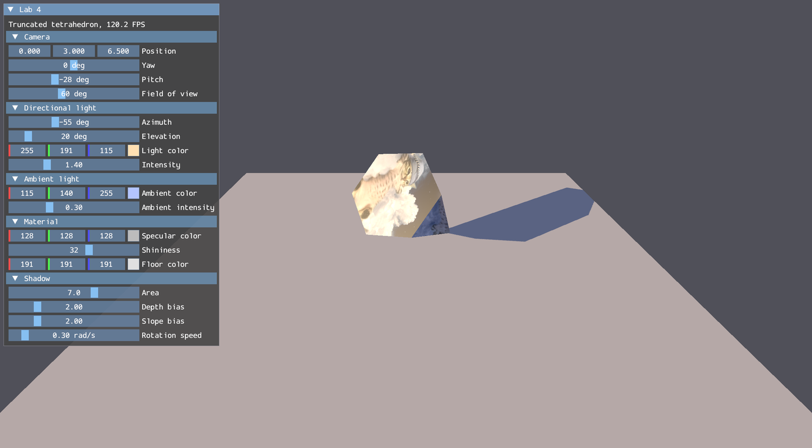
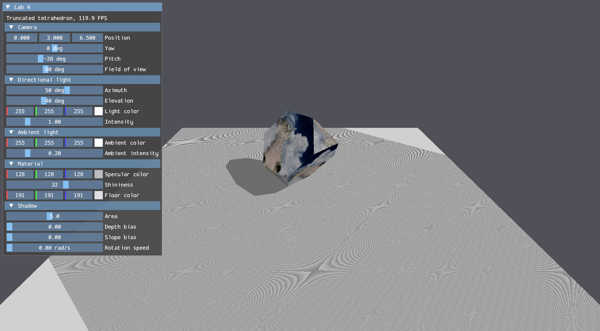

# Lab 4. Shadow Mapping

The textured truncated tetrahedron from lab 3 above a floor, casting a shadow from the sun through a shadow map rendered every frame with dynamic rendering.

## Task

Add shadow mapping to the scene of lab 3: render the depth of the scene from the sun into a texture every frame with dynamic rendering and sample it in the main fragment shader.
Variant 4: the truncated regular tetrahedron with the texture from lab 3 and a floor that receives its shadow.
The base task without the extra task is done: one directional light casts the shadow, and the area of the orthographic projection and the depth bias are changed in the ImGui interface.

## Build and run

Requirements: a C++20 compiler, CMake 3.20+, the Vulkan SDK with `glslc` in `PATH` and a GPU with Vulkan 1.3.

```bash
make run LAB=lab4
```

On Windows run `mingw32-make run LAB=lab4`; the preset is chosen by `PRESET=` (`mingw-debug` on Windows, `debug` on GNU/Linux).

## Example

The `Lab 4` window holds the camera, light, ambient and material parameters of lab 3, the floor color, and the `Shadow` section with the area of the orthographic projection and the constant and slope depth bias.







## Notes

- The device is created with Vulkan 1.3 and the `dynamicRendering` feature; the shadow pass uses `vkCmdBeginRendering` with a single depth attachment and no `VkRenderPass` or `VkFramebuffer`.
- The shadow map is a 2048×2048 `VK_FORMAT_D16_UNORM` image; every frame it goes to `DEPTH_STENCIL_ATTACHMENT_OPTIMAL`, receives the depth of the scene and goes to `SHADER_READ_ONLY_OPTIMAL` before the main render pass.
- The shadow pipeline has only a vertex shader, which computes $L \cdot M \cdot p$ with $L = O \cdot \mathrm{lookAt}(10\,t, 0, \text{up})$, where $t$ is the direction to the sun and $O$ is `glm::orthoRH_ZO` over $[-a, a]^2$ for the area $a$ and depths from 1 to 20.
- The depth bias is the rasterizer bias of the shadow pipeline, set every frame by `vkCmdSetDepthBias` with the constant and slope factors from the interface; without it the floor shadows itself (shadow acne).
- The shadow sampler has `compareEnable` with `VK_COMPARE_OP_LESS`, linear filtering and a white border, so `texture(sampler2DShadow, (uv, z))` returns the lit fraction, and everything outside the projection area is lit.
- In the main fragment shader the light-space position gives $\text{uv} = 0.5 + 0.5\,\text{ndc}_{xy}$ and $z = \text{ndc}_z$; the shadow factor multiplies the diffuse and specular terms, the ambient term stays.
- The tetrahedron and the floor share the vertex and index buffers and one dynamic uniform buffer; each object has its own structure at the offset $i \cdot s$, where $s$ is the structure size rounded up to `minUniformBufferOffsetAlignment`. The floor uses a plain color, the tetrahedron the texture.
